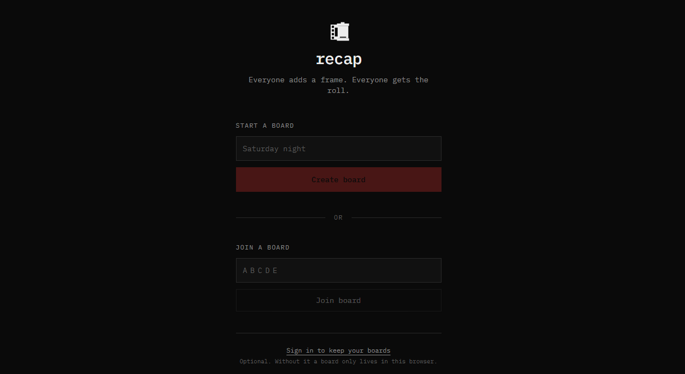

# Recap

**Everyone adds a frame. Everyone gets the roll.**

A shared photo board for parties and nights out. The host makes a board and puts up a QR code.
Guests scan it, type a name once (no account, no app) and add photos and videos from their
phone. Everything lands on one live gallery that everyone can react to and comment on. At the
end of the night the host "develops the roll": the whole night goes into a Google Photos album
or a zip, so the group gets to relive it together afterwards, not just during.

## How it feels

It's built around a 35mm roll. A board is a roll, a photo is a frame, and ending the board
develops it. The screens are flat and true black, so the only colour comes from the photos. The
gallery is a masonry wall where each photo keeps its own shape, one hot pink marks what's live
or important, and the type is General Sans throughout.

## What it does

- **Join in seconds**: a short room code or QR, then a name. Guests never sign in.
- **Photos and video**: multi-upload with a caption per photo and an honest "3 of 10" counter.
  Thumbnails are made on the phone before upload (a 9.6 MB photo becomes a 446 KB preview), so
  the gallery stays fast on party wifi. Videos up to 50 MB get a poster frame and duration.
- **Live gallery**: reactions, comments and captions update for everyone straight away, with a
  full-size lightbox and keyboard navigation.
- **Nothing is lost by accident**: every delete is soft, with a 12-second undo. Guests can
  remove their own frames, the host can remove anyone's, and nothing is ever destroyed from a
  phone.
- **Developing the roll**: at the end, the host reviews anything removed during the night (put
  back, keep or delete), then archives the board to a Google Photos album (batched, resumable)
  or downloads it as a streamed zip.
- **Hosts**: starting a board needs a Google sign-in on the host allow-list
  (`RECAP_HOST_EMAILS`), which also keeps your boards in one list and recovers a board's host key
  on a new device. Guests never sign in. An admin page can list and fully delete boards.

## Built with

Next.js 16 (App Router) · TypeScript · Tailwind CSS v4 · Firebase (Firestore, Storage, Auth) ·
Google Photos Library API.

## Running it locally

1. `npm install`
2. Copy `.env.example` to `.env.local` and fill in a Firebase web app config, a Google OAuth
   client (for Google Photos), and the admin emails.
3. Server routes use Application Default Credentials, so sign in once with
   `gcloud auth application-default login` (no key file needed).
4. `npm run dev` and open http://localhost:3001.

Checks used throughout: `npx tsc --noEmit`, `npx eslint . --max-warnings=0`, `npx next build`.

## Status

Working end to end, including a real Google Photos archive, but not public yet. Before it is:

- **Guest identity**: guests are identified by a random id in their browser. That's fine among
  friends holding a room code, but proper guest auth should come before strangers can join.
- **Limits**: only allow-listed hosts can create boards, and guest uploads and comments are only
  accepted into boards that exist and are still open (enforced in the Firestore and Storage
  rules). There's still no per-board cap, and boards don't expire.
- **Real-device testing**: video poster frames and archiving video to Google Photos haven't
  been through a real phone yet.
- **Sharing**: Google no longer lets apps share albums they created (since March 2025), so the
  host shares the finished album link by hand and pastes it back into the board.
